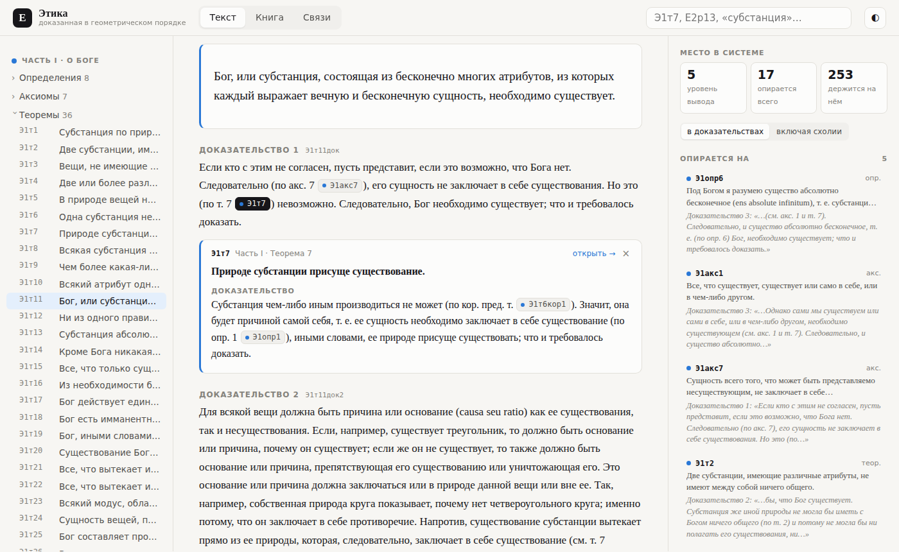
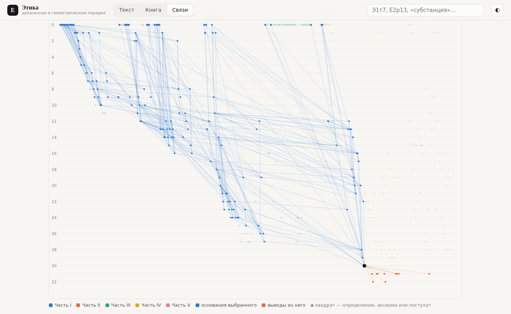

# Ethica Explorer

[](https://github.com/liberbook/ethica-explorer/actions/workflows/pages.yml)
[](https://liberbook.github.io/ethica-explorer/)
[](https://github.com/liberbook/ethica-explorer/releases/latest/download/ethica.html)
[](LICENSE)
[](NOTICE.md)


**[Русский](#русский) · [English](#english)**



## Русский

«Этика» Спинозы как система доказательств. Каждая ссылка в доказательствах («по т. 7»,
«кор. 2 т. 20, ч. I», «по пред. сх.») распознана. Щелчок раскрывает цитируемую теорему прямо в
тексте вместе с её доказательством, и так вглубь, до определений и аксиом. Текст — перевод
Н. А. Иванцова, рядом латинский оригинал 1677 года.

- **Текст**: теорема с доказательствами, королларии и схолии, на что она опирается и где
  используется, полная цепочка всех положений, на которых держится доказательство.
- **Книга**: весь текст подряд, по частям. Страница запоминает, где вы остановились.
- **Связи**: карта всех зависимостей, дерево оснований любой теоремы, самые цитируемые
  положения, связи между частями, самые длинные цепочки вывода.

Распознаны все 1521 ссылки. 35 опечаток и пропущенных ссылок русского издания исправлены по
латыни, 17 мест, которых в издании нет, восполнены по переводу В. И. Модестова. Отчёт о сверке —
по адресу `#/audit`.

**Как пользоваться:**

- откройте [сайт](https://liberbook.github.io/ethica-explorer/);
- или **[скачайте ethica.html](https://github.com/liberbook/ethica-explorer/releases/latest/download/ethica.html)** — один файл, открывается в любом браузере и работает без сети
  (все версии — в [релизах](https://github.com/liberbook/ethica-explorer/releases));
- или соберите страницу сами:

```bash
node tools/build.js   # Node.js 22+, без зависимостей
```

Как устроена сборка (по-английски): [docs/DEVELOPMENT.md](docs/DEVELOPMENT.md).



## English

Spinoza's *Ethics* read as the system of proofs it is. Every reference Spinoza makes in a
demonstration ("by P7", "by Cor. 2 P20, part I", "by the preceding Schol.") is resolved. A click
opens the cited proposition inline with its own demonstration, and so on down to the first
principles. The text is the Russian translation by N. A. Ivantsov, with the 1677 Latin alongside.

- **Text**: one proposition with its demonstrations, corollaries and scholia, what it rests on and
  where it is used, and the full chain of everything its proof depends on.
- **Book**: the whole text read straight through, part by part. The page remembers where you stopped.
- **Links**: a map of all 1,000+ dependencies, the tree of grounds of any proposition, the most
  cited propositions, how the parts depend on each other, the longest chains of proof.

All 1,521 references are recognised. The 35 misprints and dropped citations of the Russian edition
were corrected against the Latin, and 17 passages the edition omits were restored from
V. I. Modestov's translation. The audit is at `#/audit`.

**Use it:**

- open the [site](https://liberbook.github.io/ethica-explorer/);
- or **[download ethica.html](https://github.com/liberbook/ethica-explorer/releases/latest/download/ethica.html)**: one file that opens in any browser and works offline
  (every version is in [Releases](https://github.com/liberbook/ethica-explorer/releases));
- or build the page yourself:

```bash
node tools/build.js   # Node.js 22+, no dependencies
```

How it is built: [docs/DEVELOPMENT.md](docs/DEVELOPMENT.md).

## Лицензия · License

Свободная программа: код распространяется на условиях [GNU GPL версии 3 или более поздней](LICENSE).
Тексты (латынь 1677 года, переводы Н. А. Иванцова и В. И. Модестова) — общественное достояние.

Free software: the code is licensed under the [GNU GPL v3 or later](LICENSE). The texts (Latin 1677,
translations by N. A. Ivantsov and V. I. Modestov) are in the public domain. Details: [NOTICE.md](NOTICE.md).
